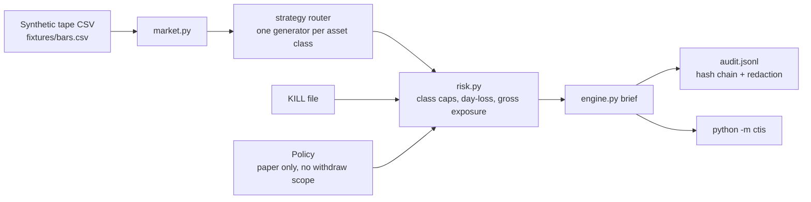

# Architecture

Reference style: the agent harness in
[zeekiankok92/aixtech-agent-harness-demo](https://github.com/zeekiankok92/aixtech-agent-harness-demo).
This repo keeps the same idea — rules, gates, a human sign-off, synthetic fixtures —
and applies it to a paper crypto information system.

## Data flow

## Asset-class sleeves

| Class | Module | Intent | Hard cap |
|---|---|---|---|
| Large-cap spot | `strategies/large_cap.py` | Trend, stand aside when ATR/close is high | 0.30 |
| Altcoin spot | `strategies/altcoin.py` | Relative strength vs BTC, liquidity floor | 0.10 |
| Stablecoin | `strategies/stablecoin.py` | Cash sleeve, depeg circuit breaker | 0.40 |
| Perpetual | `strategies/perpetual.py` | Funding carry, extreme funding = flat | 0.10 |
| Yield info | `strategies/yield_info.py` | Allow-listed APY band, no signing | 0.05 |

## What this system does not do

- No exchange adapter, no order router, no withdrawal path.
- No private keys, seed phrases, or API secrets in the repo.
- No claim of live profitability. The fixture is synthetic.
